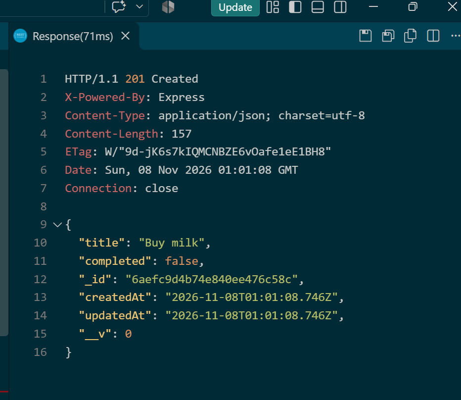
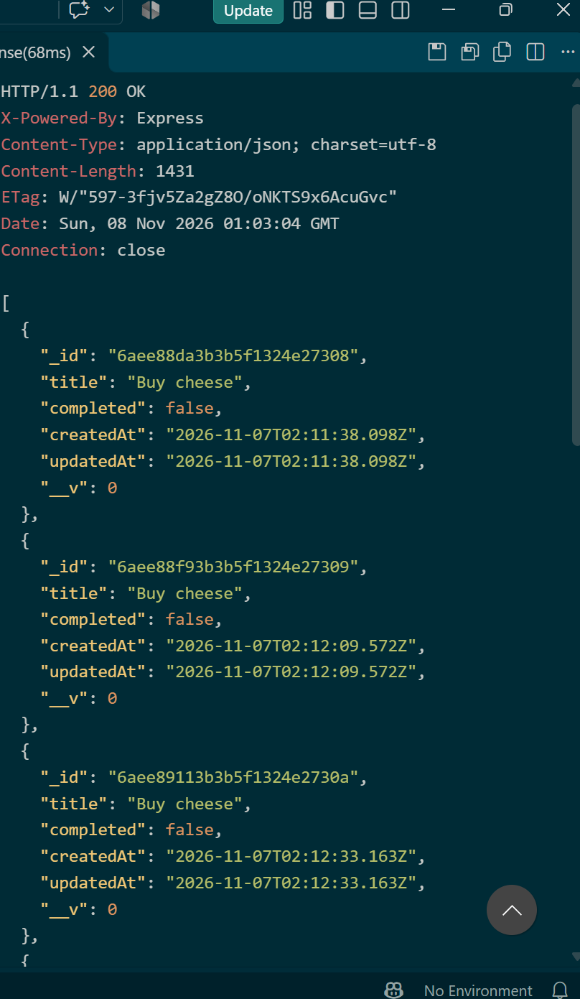
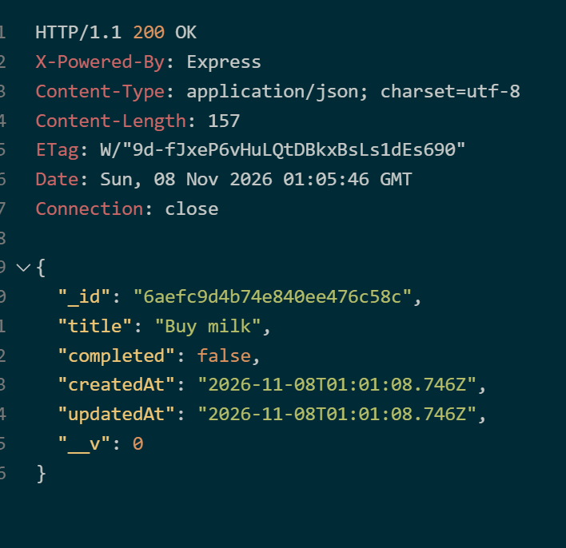
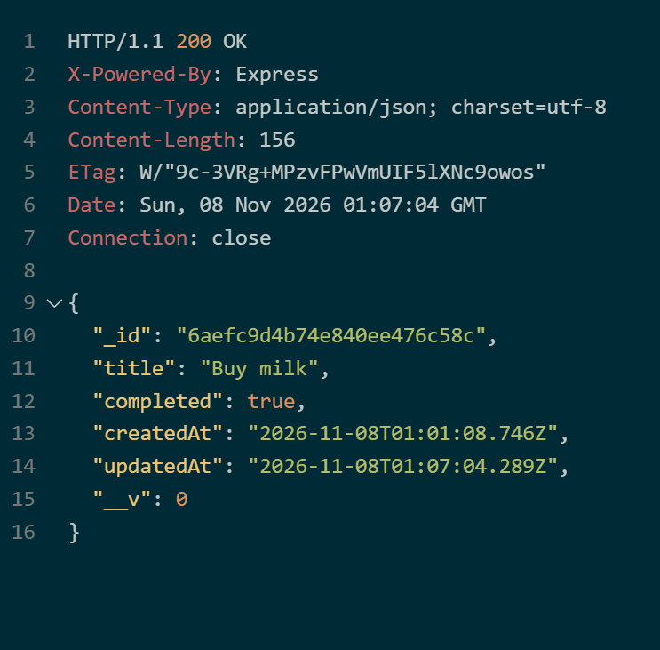
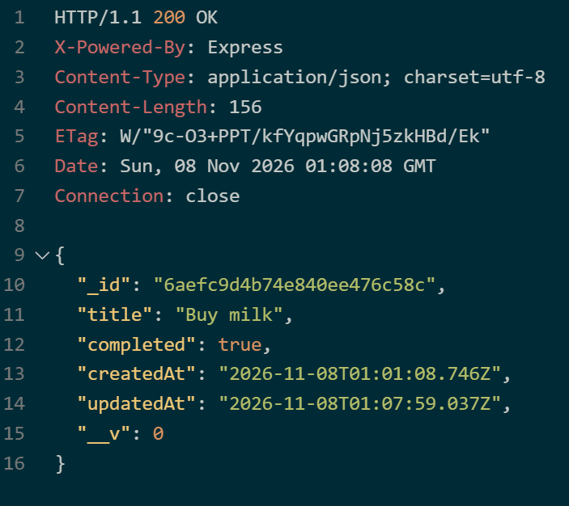
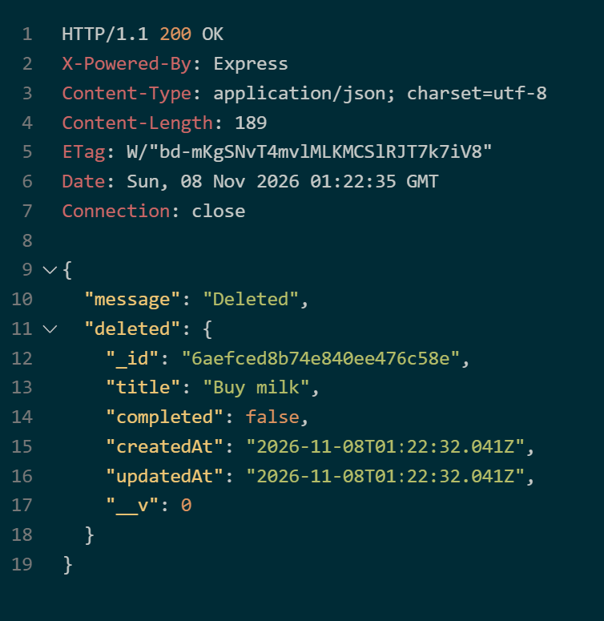
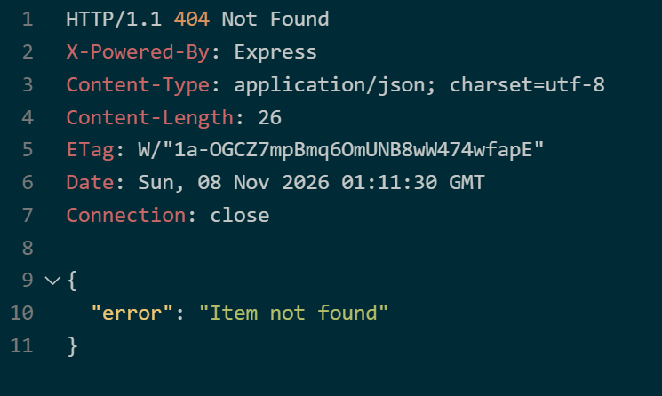
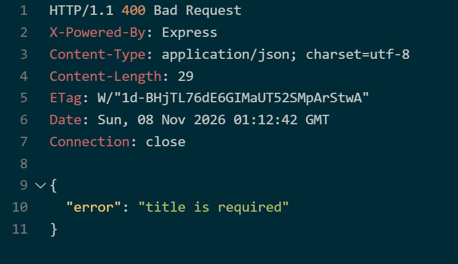

# Database-Backed API Testing Summary

Database: MongoDB Atlas (via Mongoose). Tested with the REST Client extension in VS Code against http://localhost:3000.

All data is stored in MongoDB, so it persists after the server restarts.

## Results

| # | Request | Expected | Actual |
|---|---------|----------|--------|
| 1 | POST /api/items | 201 | 201 Created |
| 2 | GET /api/items | 200 | 200 OK |
| 3 | GET /api/items/:id | 200 | 200 OK |
| 4 | PUT /api/items/:id | 200 | 200 OK |
| 5 | GET /api/items/:id (after update) | 200 | 200 OK |
| 6 | DELETE /api/items/:id | 200 | 200 OK |
| 7 | GET /api/items/:id (after delete) | 404 | 404 Not Found |
| 8 | POST /api/items (missing title) | 400 | 400 Bad Request |

## Screenshots

### 1. POST: create an item (201 Created)

### 2. GET all items (200 OK)

### 3. GET one item by id (200 OK)

### 4. PUT: update the item (200 OK)

### 5. GET the item again: the update was saved (200 OK)

### 6. DELETE: remove the item (200 OK)

### 7. GET the deleted item: not found (404)

### 8. POST with no title: validation error (400)
